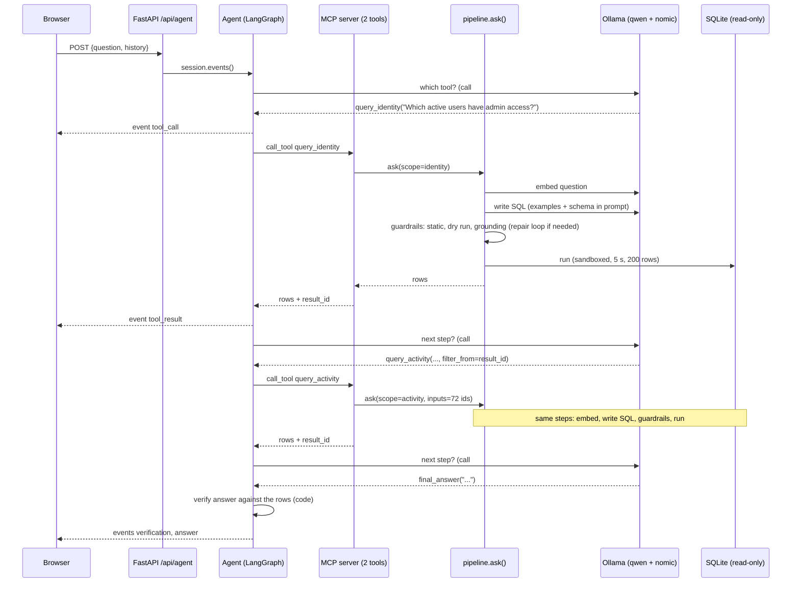

# 2. Request flow: what happens when a user asks a question

This file follows one question from the keypress to the answer on screen. Every API call, model call and guardrail is named, in
the order it happens. The examples are real output from the running system (local `qwen2.5-coder:14b`, seeded database).

Contents: [the big picture](#the-big-picture) - [Flow A: chat page, agent mode](#flow-a-chat-page-agent-mode-the-default) -
[Flow B: single query](#flow-b-single-query-post-apiask) - [Flow C: an MCP client](#flow-c-an-mcp-client-claude-desktop-etc) -
[Flow D: follow-up questions](#flow-d-follow-up-questions) - [Flow E: feedback](#flow-e-feedback) -
[Guardrails in order](#all-the-guardrails-in-the-order-they-run) - [Model calls](#every-model-call-and-why) -
[When things go wrong](#when-things-go-wrong)

## The big picture



The browser never sees SQL being written; it sees a stream of events. The agent is a separate program that talks to the MCP
server like any other MCP client would.

---

## Flow A: chat page, agent mode (the default)

Example question: **"Show me dormant admin accounts"** (a question that needs both tools). Total about 30 seconds on a laptop.

### A1. The browser (`api/static/index.html`)

1. The user types the question and presses Enter. The page adds the message to the chat and calls `askAgent(question)`.
2. It sends `POST /api/agent` with JSON `{"question": "...", "history": [...]}`. `history` is the last three finished turns of this
   chat as `{question, answer}` pairs (only those with an answer). It is empty for a first question. The page keeps the history in
   memory; nothing is stored on the server.
3. It reads the response as a stream, one JSON object per line, and draws each step as it arrives.

### A2. The API endpoint (`api/agent_routes.py`)

4. FastAPI validates the body (`AgentRequest`): question 1 to 1000 characters, at most 6 history turns accepted (the last 3 used).
   Bad input is rejected with 422 before anything else happens.
   **Intent check** (`guardrails/intent.py`, plain code, runs before anything else): a request to change data ("can you delete all
   admins") is answered immediately with a fixed read-only message, as one `answer` event with `refused: true`. No model is used and
   none of the steps below happen. Questions that merely *mention* changes ("which users were deleted last month?") pass through.
5. It returns a `StreamingResponse` (`application/x-ndjson`) fed by `event_lines()`. The agent code is imported *here*, lazily,
   because LangGraph is an optional install; if it is missing the stream carries one `error` event instead of a 500.

### A3. Starting the agent (`agent/session.py`, `agent/tools.py`)

6. `session.events()` opens a connection to the MCP server (`open_tools`). By default it launches the server as a subprocess over
   stdio (`python -m identity_mcp.mcp_server`); if `IDENTITY_MCP_AGENT_SERVER` is set it connects to that URL instead.
7. It asks the server what tools exist (`list_tools`) and wraps each as a LangChain tool, simplifying the JSON schema so small
   models call it correctly. There are two: `query_identity` and `query_activity`.
8. It builds the graph (`agent/graph.py`) with a `ChatOllama` model at temperature 0 and the history converted to earlier chat
   messages.

### A4. Step 1: the model chooses a tool (model call #1)

9. **Model call.** The system prompt (`agent/prompts.py`) tells the model it has two tools, how to chain them with `filter_from`,
   and to finish by calling `final_answer`. The model sees the history and the question.
10. It replies with a tool call: `query_identity("Which active users have admin access?")`. If a small model writes the call as
    plain text instead (qwen sometimes does), `agent/recovery.py` converts it into a real call, but only for tool names we offered.
11. The page receives `{"type": "tool_call", ...}` and shows "→ identity: Which active users have admin access?".

### A5. Step 1: the tool runs (inside the MCP server)

12. The graph's `tools` node calls the server (`call_tool`). Empty or null arguments are removed first (`prune`), because models
    send `{"result_id": null}` for "not given".
13. `mcp_server.query_identity` runs `_run(IDENTITY, question, None)`, which calls **`pipeline.ask(question, scope=IDENTITY,
    summarize_answer=False)`**. This is where the SQL gets made and checked:

| Sub-step | What happens | Where |
|----------|--------------|-------|
| a. Rewrite | skipped: no history at this level (the agent handles context itself) | `context/conversation.py` |
| b. **Retrieve** | the question is embedded (**embedding call**), compared with every bank question, and the 4 closest with score at least 0.5 are kept. Bank entries that read tables outside the identity scope are hidden first. | `rag/retrieval.py` |
| c. **Build prompt** | system prompt = role + the *identity* tables only + rules + the 4 examples (best match last) | `pipeline/prompts.py` |
| d. **Write SQL** (**model call**) | the model must answer in JSON `{"sql": "..."}` | `pipeline/sql.py` |
| e. **Check** | static validation, dry run, value grounding; if any fails, the reasons go back to the model for up to 2 repairs (**more model calls**) | `guardrails/`, `pipeline/sql.py` |
| f. **Execute** | the query runs on a sandboxed read-only connection, 5 s limit, at most 200 rows | `pipeline/executor.py` |
| g. Summarize | skipped: the calling agent reasons over rows itself (the slowest model call is saved) | |

    The SQL that came out for this step (real):

    ```sql
    SELECT DISTINCT u.id, u.name, u.email FROM users u
    JOIN access_grants g ON g.user_id = u.id
    JOIN entitlements e ON e.id = g.entitlement_id
    WHERE u.status = 'active' AND e.is_admin = 1 ORDER BY u.name
    ```

14. Back in `mcp_server._run`, the rows are shaped for the caller: the first 25 rows, `row_count` (72), the `sql`, and a short
    **`result_id`** (`r_f0cddb`). The full result (up to 200 rows) is kept in memory for about 30 minutes under that id.
15. The page receives `{"type": "tool_result", ...}` and shows "← identity: 72 rows", with the SQL and rows folded underneath.

### A6. Step 2: chaining to the activity tool (model call #2)

16. **Model call.** The model sees the 72-row result and its `result_id`. The prompt told it: *ask the second tool with
    `filter_from = {result_id, column: "id"}`*. It calls
    `query_activity("Which of these users had no activity in the last 90 days?", filter_from={result_id: "r_f0cddb", column: "id"})`.
    This is the point of the whole design: the model does not copy 72 ids; it passes a reference.
17. In the server, `_run` first resolves the reference: `handoff.STORE.values("r_f0cddb", "id")` returns the 72 ids (or an error
    the agent can read: unknown id, expired, missing column).
18. `pipeline.ask(..., scope=ACTIVITY, inputs=<72 ids>)` runs the same sub-steps with three differences:
    - the prompt shows only the *activity* tables, plus a rule: *"the ids from the earlier step are in a table named `input`
      with one column `value`"*;
    - the check refuses a query that never reads `input` (otherwise the model could ignore the earlier result);
    - before checking and running, the pipeline prepends `WITH input(value) AS (VALUES (169), (70), ...)` to the query, so `input`
      is an ordinary table inside the query.

    Real SQL for this step:

    ```sql
    SELECT u.id, u.name, u.email FROM users u
    WHERE u.id IN (SELECT value FROM input)
      AND NOT EXISTS (SELECT 1 FROM activity_events a
                      WHERE a.user_id = u.id AND a.ts >= date('2026-11-01', '-90 days'))
    ```

    Because `input` is a normal table, "who has *no* activity" is a plain `NOT EXISTS`. That set difference is exactly what two
    separate data stores could not express in one query.
19. Result: 15 rows, a new `result_id`. The page shows "← activity: 15 rows".

### A7. Finishing and checking the answer (model call #3, then code)

20. **Model call.** The model now has everything and calls `final_answer("The following dormant admin accounts ...")`. Finishing
    is an explicit tool call because small models otherwise write "Now let's check their activity" as plain text and the loop
    would stop half way. Plain text is answered with a nudge (at most twice) telling the model to call a tool or `final_answer`.
21. The graph's `verify` node (`agent/verify.py`, plain code, no model) compares the answer text with the tool results:
    every number must appear in the results or the questions asked, every name-like bullet must match a result cell, and a list that
    names most but not all rows is flagged. If it fails, the model gets one chance to fix it (`revise`); if it still fails, the
    answer goes out with a visible caveat. Here it passed: `{"type": "verification", "ok": true}`.
22. The stream ends with `{"type": "answer", "text": "...", "steps": 3, "verified": true, "elapsed_ms": 29918}`.

### A8. Back in the browser

23. The page replaces the live trace with the answer on top and the steps folded below ("Steps (5)"), shows "29.9s - 3 model calls
    - checked against the results", remembers `{question, answer}` as history, and shows 👍/👎 buttons (see [Flow E](#flow-e-feedback)).

The events the browser received, in order (rows shortened):

```
{"type": "tool_call",   "name": "query_identity", "question": "Which active users have admin access?", "filter_from": null}
{"type": "tool_result", "name": "query_identity", "row_count": 72, "columns": ["id","name","email"], "sql": "SELECT DISTINCT ...", "result_id": "r_f0cddb"}
{"type": "tool_call",   "name": "query_activity", "question": "Which of these users had no activity in the last 90 days?", "filter_from": {"result_id": "r_f0cddb", "column": "id"}}
{"type": "tool_result", "name": "query_activity", "row_count": 15, "sql": "SELECT u.id, ... FROM input ...", "result_id": "r_81283e"}
{"type": "verification","ok": true, "issues": []}
{"type": "answer",      "text": "The following dormant admin accounts ...", "steps": 3, "verified": true, "elapsed_ms": 29918}
```

---

## Flow B: single query (`POST /api/ask`)

The chat page's drop-down can switch to "Single query". There is no agent and no scope: one question, one SQL, one summary.
Example: **"How many suspended users have MFA disabled?"**

1. Browser sends `POST /api/ask {"question", "history"}`. FastAPI validates it (`AskRequest`).
2. `pipeline.ask(question, history=...)` runs:
   1. **Rewrite** (only with history; **model call**): a follow-up like "tell me more about him" becomes a standalone question. See
      [Flow D](#flow-d-follow-up-questions).
   2. **Retrieve** (**embedding call**, 86 ms in this run). The four closest bank questions were:

      | id | question | score |
      |----|----------|-------|
      | ex-078 | How many privileged users lack MFA? | 0.695 |
      | ex-013 | What percentage of active users have MFA enabled? | 0.692 |
      | ex-012 | Which active users do not have MFA enabled? | 0.685 |
      | ex-082 | Which users with admin access to high-criticality applications have no MFA? | 0.681 |

   3. **Write SQL** (**model call**, 7.3 s): `SELECT COUNT(*) AS suspended_users_without_mfa FROM users WHERE status = 'suspended' AND mfa_enabled = 0`
   4. **Check** (21 ms): static, dry run, grounding all passed; zero repairs.
   5. **Execute** (1 ms): one row, `[0]`.
   6. **Summarize** (**model call**, 1.2 s): "0 suspended users have MFA disabled." The prompt contains only the question, the SQL and
      the first 50 rows, with rules such as "quote numbers exactly" and "never guess gender".
3. The response is one JSON document with `answer`, `sql`, `columns`, `rows`, `examples` (what retrieval found), `attempts`
   (including rejected queries), `repairs` and `timings_ms`. The page shows the answer with collapsible SQL and results.

The same code path serves the MCP tools; the difference is only `scope`, `inputs` and `summarize_answer`.

---

## Flow C: an MCP client (Claude Desktop etc.)

Any MCP client can use the server directly, with no agent of ours involved.

1. The client starts `uv run python -m identity_mcp.mcp_server` (stdio) or connects to `http://localhost:8000/mcp` (the FastAPI app
   mounts the same server).
2. It lists the tools and shows their descriptions to *its* model, which decides what to call.
3. Each call is the same `_run(scope, question, filter_from)` as in step A5 and returns `columns`, `rows` (first 25), `row_count`,
   `sql`, `result_id` and, on failure, `error`. No prose answer is written; the client's model does that.

The orchestration (call identity, then pass its `result_id` to activity) is the client's job, as with any MCP server. Our
LangGraph agent is simply one such client.

---

## Flow D: follow-up questions

A second question often depends on the first: "Show me more info on arjun" after a list that included Arjun Cohen.

**In agent mode.** The page sends the last three `{question, answer}` pairs. `agent/graph.initial_state()` places them in front of
the new question as earlier chat messages, so the model resolves "she" itself and writes a self-contained tool question. Real
example: history *"Who is Elena Johnson?"*, new question *"what groups is she in?"* became the tool call
`query_identity("What groups is Elena Johnson in?")`. Only text is passed on, not old rows, so a follow-up always fetches fresh data.

**In single-query mode.** `context/conversation.py` makes one extra model call before anything else: it shows a rewriter the last
three turns (question, short answer, first five rows with ids and emails) and asks for one standalone question, such as
*"Show more info on the user with id 436 (Arjun Cohen, arjun.cohen36@acme.example)"*. Retrieval and SQL generation then see an ordinary
question. If the rewrite fails the original question is used and a `warning` is returned.

The server stores no conversations either way (it is stateless); the client sends what is needed with each request. History is
untrusted input, so it is length-limited on arrival and again before use.

---

## Flow E: feedback

1. After an answer the page shows 👍/👎. A 👎 asks "What was wrong?" with a text prompt.
2. The page sends `POST /api/feedback` with the rating, the question, the answer, the comment, the mode, whether the answer was
   verified, and the steps (tool, question, SQL, whether it used an earlier result, any error) it collected while streaming.
3. `feedback/store.py` writes one row into `feedback.db` (a separate, writable SQLite file; the identity database stays read-only).
4. Later a person runs `uv run python -m identity_mcp.feedback`. For each pending item:
   - 👍: each qualifying step is shown with its SQL and row count; pressing `a` appends it to `examples/examples.md`
     as the next `ex-NNN` (after re-validating and re-running the SQL and checking the question is new). From then on retrieval can
     show it to the model.
   - 👎: the reviewer types the correct SQL; it is validated and run, then added to `evals/cases.json` as `f-NN`, so every later eval
     run includes it.
5. Nothing is promoted automatically.

---

## All the guardrails, in the order they run

For one generated query (`pipeline/sql.check_sql`, then execution):

| # | Check | What it catches | Example message |
|---|-------|-----------------|------------------------|
| -1 | **Intent** (before everything) | a request to delete, change, grant or create something | "This assistant is read-only, so I can't delete anything. ..." |
| 0 | **Unused input** (hand-off only) | the query ignores the earlier result | the query must read the `input` table |
| 1 | **Length** | a query over 4000 characters | "The query is too long ..." |
| 2 | **Parse** (sqlglot) | not valid SQL | "SQL syntax error: ..." |
| 3 | **One SELECT only** | several statements, INSERT/UPDATE/DELETE/DROP/PRAGMA/ATTACH, even nested | "Only SELECT queries are allowed, got DELETE." |
| 4 | **Functions** | anything outside an allow-list (blocks `load_extension`, `randomblob`, `printf`, ...) | "Function load_extension() is not allowed." |
| 5 | **Fixed "today"** | `date('now')`, `CURRENT_DATE` | "Do not use 'now': today is fixed at 2026-11-01." |
| 6 | **Known tables** | invented tables, table-valued functions, schema-qualified names | "Unknown table 'x'. Available tables: ..." |
| 7 | **Scope** | a table outside the tool's scope | "Table 'access_grants' is not available in the activity tool. This tool covers: activity_events, applications, users." |
| 8 | **Joins** | a join with no condition (cartesian product, the usual cause of timeouts) | "The join with 'g' has no join condition ... Add ON ..." |
| 9 | **Columns** | invented or ambiguous columns | "Column check failed: nme does not exist. Tables in this query: users(id, email, name, ...)." |
| 10 | **Dry run** | anything SQLite itself refuses to compile (`EXPLAIN` on the sandbox connection) | SQLite's own error text |
| 11 | **Value grounding** | a filter on a value that is not in the data (`department = 'Eng'`) | "users.department has no value 'Eng'. Closest real values: 'Engineering'." |
| 12 | **Sandbox at run time** | even if 1-11 were wrong: SQLite's authorizer allows only SELECT, known tables (in scope) and allowed functions; the connection is read-only (`mode=ro`, `query_only`); a size limit stops giant values | "SQLite refused an operation the sandbox does not allow" |
| 13 | **Limits** | 5 second timeout, at most 200 rows returned | "The query ran longer than 5 seconds and was stopped." |

The messages for checks 3, 4, 7, 8, 9 and 11 are verbatim output from the running system; the others are shortened.

Checks 1-9 are *static* (the query is only read, never run). 10 is a *dry run*. 12 holds even if sqlglot and SQLite read a query
differently, because it uses SQLite's own parser. Messages are written so the model can act on them: they name the problem and the
valid alternatives, and they are fed back in the repair loop.

Around the agent: **tool-call recovery** (text to real calls), **argument pruning**, a **step budget** (6 model calls per question),
**nudges** for plain text, and the **answer verification** described in A7.

---

## Every model call and why

| Call | Model | Where | When | Purpose |
|------|-------|-------|------|---------|
| Embedding of the question | `nomic-embed-text` | `rag/retrieval.py` | once per pipeline run (bank embeddings are cached on disk) | find similar examples |
| Rewrite follow-up | `qwen2.5-coder:14b` | `context/conversation.py` | single-query mode with history only | make the question standalone |
| Write SQL | same | `pipeline/sql.py` | once per pipeline run | produce the query as JSON |
| Repair SQL | same | `pipeline/sql.py` | 0 to 2 times, only if a check failed | fix the query given the reasons |
| Summarize | same | `pipeline/answer.py` | single-query mode only (not for MCP/agent) | write the answer from the rows |
| Agent step | `qwen2.5-coder:14b` (override: `IDENTITY_MCP_AGENT_MODEL`) | `agent/graph.py` | 3 to 6 times per question | choose a tool or finish |

The dormant-admins question above made 3 agent calls + 2 SQL-writing calls + 2 embedding calls = 7 model calls, no repairs, no
summary. Everything else (validation, grounding, verification, hand-off, sandbox) is ordinary code with no model.

---

## When things go wrong

| Situation | What happens | What the user sees |
|-----------|--------------|--------------------|
| Ollama is not running | `llm.LLMError`; retrieval degrades to "no examples" with a warning, SQL generation fails | answer: "I couldn't reach the language model: ..." |
| Generated SQL fails a check | reasons sent back, up to 2 repairs; same query twice stops early | after the last attempt: "I couldn't produce a valid query ... Problems found: ..." and nothing runs |
| Value not in the data (say, an application called `Asana` that does not exist) | grounding rejects a made-up substitute | the model may keep the real value and return nothing, or the answer says it is missing |
| Query too slow / too big | the sandbox stops it | "The query ran longer than 5 seconds ..." |
| Tool call fails in the agent | the error comes back as a message the model can read | the model reruns, rephrases or uses the other tool |
| Bad `filter_from` (expired id) | `HandoffError` text returned as `error` | the model re-runs the first step |
| Request to change data ("delete all admins") | the intent check answers at once, in the endpoint and again in `pipeline.ask` | "This assistant is read-only, so I can't delete anything ..."; no model call |
| Model never finishes | after 6 model calls the graph stops | "I ran out of steps (6) before finishing ..." with what was done |
| Answer disagrees with the data | `verify` sends it back once, then adds a note | the answer with "(Note: this answer could not be fully checked ...)" and "not fully verified" |
| Agent not installed / server unreachable | an `error` event instead of a crash | "The agent could not finish: ..." |

Expected failures never raise out of `pipeline.ask`; they come back in the result's `error` and `answer`, so a caller always gets an
explanation.
